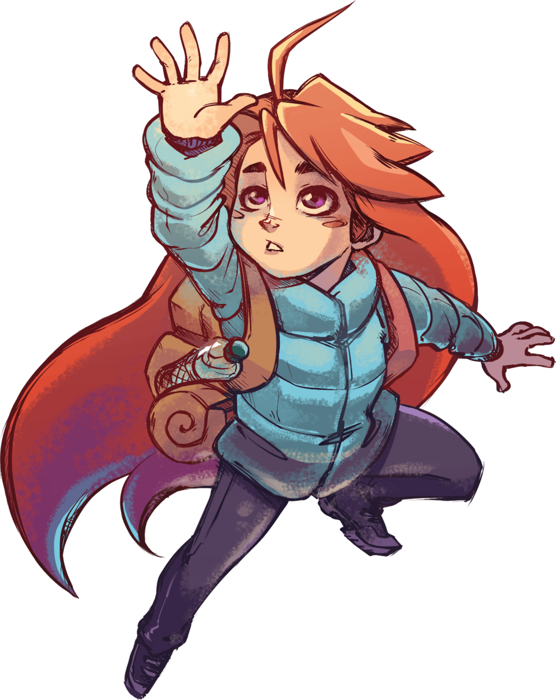

  <samp>Hai!!! ^_^ 
    I'm Abi, and this is where i keep my projects. 
    Most projects here are for my daily tasks, but feel free to look!
  </samp>  
  <!-- rotate:start -->
  
<!-- rotate:end -->  
  <samp>
    This picture changes at midnight UTC. 
    I'm currently learning, so expect lots of slop >_<
  </samp>

<!-- stats:start -->

<pre>
languages · 5 repos
TypeScript    ████████████       74.7%
Python        ██                 12.8%
TeX           █                   8.3%
BibTeX Style  █                   1.9%
Makefile      █                   1.5%
Batchfile     █                   0.6%
Other         █                   0.2%
</pre>

<!-- stats:end -->
